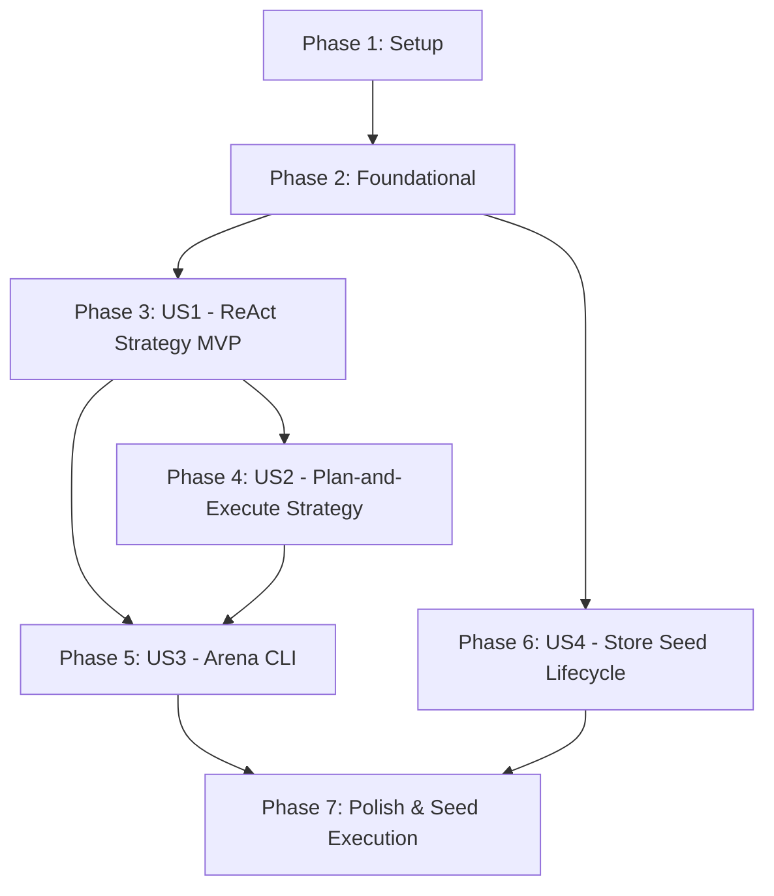

# Tasks: OpsPilot Reasoning Core

**Feature**: OpsPilot Reasoning Core (`001-reasoning-core`)  
**Specification**: [spec.md](spec.md)  
**Implementation Plan**: [plan.md](plan.md)  
**Status**: Ready for Implementation  

---

## Phase 1: Setup (Shared Infrastructure)

**Purpose**: Project initialization, environment configuration, and core telemetry types.

- [X] T001 Create centralized environment configuration module with Zod validation in `src/config/env.ts`
- [X] T002 [P] Define core reasoning types, metrics, and trace contracts (`ReasoningStrategy`, `TraceEvent`, `StrategyMetrics`) in `src/agents/types.ts`
- [X] T003 [P] Implement trace formatting and console serialization utilities in `src/agents/trace.ts`
- [X] T004 [P] Create deterministic unit tests for trace serialization and formatting in `src/agents/trace.test.ts`

---

## Phase 2: Foundational (Blocking Prerequisites)

**Purpose**: Core persistence models, data store abstraction, operational incident tools, and LLM model factory.

**⚠️ CRITICAL**: Must be completed before reasoning strategy implementations can begin.

- [X] T005 Initialize Sequelize database connection with MySQL and in-memory SQLite support in `src/models/db.ts`
- [X] T006 [P] Implement Service Sequelize model schema in `src/models/service.model.ts`
- [X] T007 [P] Implement Alert Sequelize model schema in `src/models/alert.model.ts`
- [X] T008 [P] Implement Incident Sequelize model schema in `src/models/incident.model.ts`
- [X] T009 Implement `IOpsStore` interface with Sequelize and in-memory store implementations in `src/models/store.ts`
- [X] T010 Implement operational tools (`list_alerts`, `open_incident`, `resolve_incident`) with Zod schemas in `src/agents/tools.ts`
- [X] T011 [P] Create deterministic unit tests for operational tools schemas and store queries in `src/agents/tools.test.ts`
- [X] T012 Implement centralized OpenRouter model factory with temperature 0 in `src/agents/model.ts`

**Checkpoint**: Foundational store, operational tools, and model factory are ready.

---

## Phase 3: User Story 1 - Reactive Alert Investigation and Incident Response (Priority: P1) 🎯 MVP

**Goal**: Enable OpsPilot to autonomously triage firing alerts, investigate service status, and open/resolve incidents using the LangGraph ReAct agent pattern while capturing an ordered, typed event trace and execution metrics.

**Independent Test**: Execute the ReAct strategy with a mock triage prompt; verify that it calls `list_alerts` and `open_incident`, returns an answer, and outputs an ordered trace (`thought`, `action`, `observation`, `answer`) with `llmCalls` and `latencyMs`.

### Implementation for User Story 1

- [X] T013 [P] [US1] Create unit tests for ReAct strategy trace event capture and iteration bounds in `src/agents/react.test.ts`
- [X] T014 [US1] Implement `ReActStrategy` using LangGraph prebuilt tool agent with message/callback trace inspection in `src/agents/react.ts`
- [X] T015 [US1] Implement iteration limit enforcement and LLM call counting in `src/agents/react.ts`

**Checkpoint**: User Story 1 (ReAct Strategy MVP) is fully functional and testable independently.

---

## Phase 4: User Story 2 - Structured Multi-Step Planning and Execution (Priority: P2)

**Goal**: Enable OpsPilot to plan a multi-step incident resolution workflow, execute individual steps with operational tools, and dynamically re-evaluate remaining steps after each execution, capped at a maximum of 8 steps.

**Independent Test**: Submit a multi-phase operational task to `PlanAndExecuteStrategy`; verify the initial structured plan generation, sequential step tool execution, dynamic replanning transitions, and strict 8-step hard limit.

### Implementation for User Story 2

- [X] T016 [P] [US2] Create unit tests for Plan-and-Execute graph state transitions and 8-step cap in `src/agents/plan-and-execute.test.ts`
- [X] T017 [US2] Implement planner node with structured output schema (`steps: string[]`) in `src/agents/plan-and-execute.ts`
- [X] T018 [US2] Implement executor node dispatching single-step tool calling in `src/agents/plan-and-execute.ts`
- [X] T019 [US2] Implement replanner node evaluating completed steps, updating remaining steps, and terminating at empty plan or 8 steps in `src/agents/plan-and-execute.ts`
- [X] T020 [US2] Assemble and compile the LangGraph `StateGraph` for `PlanAndExecuteStrategy` in `src/agents/plan-and-execute.ts`

**Checkpoint**: User Story 2 (Plan-and-Execute Strategy) functions independently alongside User Story 1.

---

## Phase 5: User Story 3 - Strategy Arena Benchmarking and Comparative Inspection (Priority: P3)

**Goal**: Provide a CLI arena runner that executes multiple reasoning strategies against the same input, streams typed event traces, and outputs a comparative table of latency and LLM call counts.

**Independent Test**: Run `npm run arena -- --strategies react,plan-and-execute --max-iterations 8` and verify comparative trace logging and formatted metrics summary table.

### Implementation for User Story 3

- [X] T021 [P] [US3] Create unit tests for Arena argument parsing and metrics table formatting in `src/arena.test.ts`
- [X] T022 [US3] Implement CLI arguments parsing with Zod schema (`--strategies`, `--max-iterations`, `--prompt`) in `src/arena.ts`
- [X] T023 [US3] Implement runner orchestration executing selected strategies sequentially or concurrently in `src/arena.ts`
- [X] T024 [US3] Implement terminal output formatter rendering styled traces and comparative metrics summary table in `src/arena.ts`

**Checkpoint**: User Story 3 (Arena CLI) successfully benchmarks both ReAct and Plan-and-Execute engines.

---

## Phase 6: User Story 4 - Ground-Truth Operations Store & Seeding Lifecycle (Priority: P4)

**Goal**: Provide deterministic seeding of 5 services and 6 alerts (3 firing, 3 resolved) and administrative script execution for development, arena benchmarking, and automated testing.

**Independent Test**: Run the seed script and verify via store query that exactly 5 services and 6 alerts (3 firing, 3 resolved) exist with valid relationships.

### Implementation for User Story 4

- [X] T025 [P] [US4] Create unit tests validating baseline seed dataset integrity in `src/models/store.test.ts`
- [X] T026 [US4] Implement database seeding script populating 5 services and 6 alerts (3 firing, 3 resolved) in `src/scripts/seed.ts`
- [X] T027 [US4] Configure `seed` script in `package.json` for standalone execution via `npm run dev -- --seed` or `tsx src/scripts/seed.ts`

**Checkpoint**: User Story 4 (Store Seeding Lifecycle) delivers baseline operational data reliably.

---

## Phase 7: Polish & Cross-Cutting Concerns

**Purpose**: System integration, entrypoint export, test suite validation, and execution of initial seed.

- [X] T028 Wire exports and module interface in `src/index.ts`
- [X] T029 Execute and verify full offline test suite (`npm test`) with zero failures
- [X] T030 Execute TypeScript type checking (`npm run typecheck`) and resolve any compiler warnings
- [X] T031 Run initial seed execution via `npx tsx src/scripts/seed.ts` to populate operational baseline data
- [X] T032 Validate end-to-end scenarios per `specs/001-reasoning-core/quickstart.md`

---

## Dependencies & Execution Order

### Phase Dependencies

### User Story Dependencies

- **Foundational (Phase 2)**: Prerequisite for all stories. Blocks US1, US2, US3, US4.
- **US1 - ReAct Strategy (P1)**: Can begin immediately after Foundational. Delivers MVP.
- **US2 - Plan-and-Execute (P2)**: Can be implemented after Foundational, reusing tools and model factory.
- **US3 - Arena CLI (P3)**: Depends on US1 and US2 to benchmark both strategies.
- **US4 - Store Seed (P4)**: Depends on Foundational store models and repository.
- **Polish (Phase 7)**: Depends on all previous phases.

### Parallel Opportunities

- **Setup [P]**: T002, T003, T004 can run in parallel.
- **Foundational [P]**: Models T006, T007, T008, and tests T011 can run in parallel once DB connection T005 is defined.
- **US1 [P]**: Tests T013 can be authored in parallel with initial strategy scaffolding.
- **US2 [P]**: Tests T016 can be authored in parallel with graph scaffolding.
- **US3 [P]**: Tests T021 can run in parallel with CLI scaffolding.
- **US4 [P]**: Tests T025 can run in parallel with seed script implementation T026.

---

## Implementation Strategy

### MVP First (User Story 1 Only)
1. Complete Phase 1 (Setup) and Phase 2 (Foundational).
2. Complete Phase 3 (User Story 1 - ReAct Strategy).
3. Validate ReAct strategy independently with offline tests and mock tools.

### Incremental Delivery
1. Foundation Ready: Environment, Store, Tools, Model Factory.
2. Increment 1: ReAct Strategy with trace capture (MVP).
3. Increment 2: Plan-and-Execute Graph with 8-step limit.
4. Increment 3: Arena CLI for side-by-side benchmarking.
5. Increment 4: Complete Seed script populating baseline data.
6. Final Verification: `npm test` and `npm run typecheck` 100% green.
