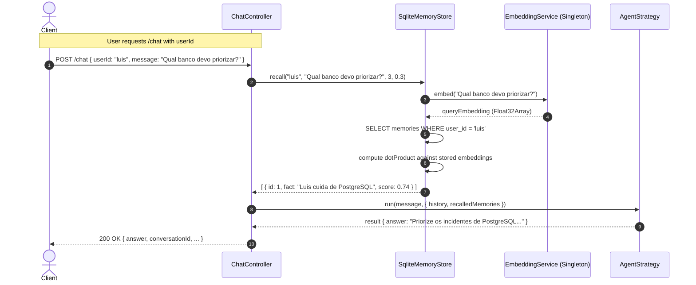

# Data Model: Semantic Memory Store & Context Recall

**Feature**: `008-semantic-memory` | **Date**: 2026-09-30

---

## 1. Database Schema

### Table: `memories`

```sql
CREATE TABLE IF NOT EXISTS memories (
  id         INTEGER PRIMARY KEY AUTOINCREMENT,
  user_id    TEXT    NOT NULL,
  fact       TEXT    NOT NULL,
  embedding  BLOB    NOT NULL,
  created_at TEXT    NOT NULL DEFAULT (datetime('now'))
);

CREATE INDEX IF NOT EXISTS idx_memories_user
  ON memories (user_id, id);
```

### Column Specifications

| Column | Type | Constraints | Description |
|---|---|---|---|
| `id` | `INTEGER` | `PRIMARY KEY AUTOINCREMENT` | Unique numeric identifier for the memory record. |
| `user_id` | `TEXT` | `NOT NULL` | Partition key scoping the memory to a specific user. |
| `fact` | `TEXT` | `NOT NULL` | Natural language text of the learned operational fact. |
| `embedding` | `BLOB` | `NOT NULL` | 384-dimensional float vector stored as raw binary (1536 bytes). |
| `created_at` | `TEXT` | `NOT NULL DEFAULT (datetime('now'))` | ISO timestamp of record insertion. |

---

## 2. Domain Types & Interfaces

```typescript
// src/models/memory.ts

export interface MemoryRecord {
  id: number;
  userId: string;
  fact: string;
  embedding: Float32Array;
  createdAt: Date;
}

export interface RecalledMemory {
  id: number;
  fact: string;
  score: number;
}

export interface RememberResult {
  stored: boolean;
  id: number;
  similarity?: number;
}

export interface IMemoryStore {
  /**
   * Persists a fact for the user.
   * Deduplicates if any existing fact has similarity > 0.92.
   */
  remember(userId: string, fact: string): Promise<RememberResult>;

  /**
   * Recalls the top-K facts for the user matching query similarity >= minScore.
   * @default limit 3
   * @default minScore 0.3
   */
  recall(userId: string, query: string, limit?: number, minScore?: number): Promise<RecalledMemory[]>;

  /**
   * Deletes a memory record for the specified user.
   * @returns true if deleted, false if not found or unauthorized
   */
  forget(userId: string, memoryId: number): Promise<boolean>;

  /**
   * Lists all stored memories for a user (for inspection / tests).
   */
  list(userId: string): Promise<Omit<MemoryRecord, "embedding">[]>;

  /**
   * Closes database connection (if needed, e.g. on test teardown).
   */
  close?(): void;
}
```

---

## 3. Mathematical Operations & Constants

### Vector Embedding Properties
- **Model**: `Xenova/all-MiniLM-L6-v2`
- **Dimensions**: 384
- **Pooling**: `mean`
- **Normalization**: `normalize: true` ($\|v\|_2 = 1.0$)

### Similarity Calculation (Dot Product)
Given unit vectors $\mathbf{u}$ and $\mathbf{v}$ of length 384:
$$\text{similarity}(\mathbf{u}, \mathbf{v}) = \sum_{i=0}^{383} u_i \cdot v_i$$

### Thresholds
| Parameter | Value | Purpose |
|---|---|---|
| `DEDUP_SIMILARITY_THRESHOLD` | `0.92` | Rejects/deduplicates near-identical facts on `remember()` |
| `DEFAULT_MIN_SCORE` | `0.30` | Minimum relevance threshold on `recall()` |
| `DEFAULT_RECALL_LIMIT` | `3` | Maximum number of facts returned by `recall()` |

---

## 4. Lifecycle & Data Flow


