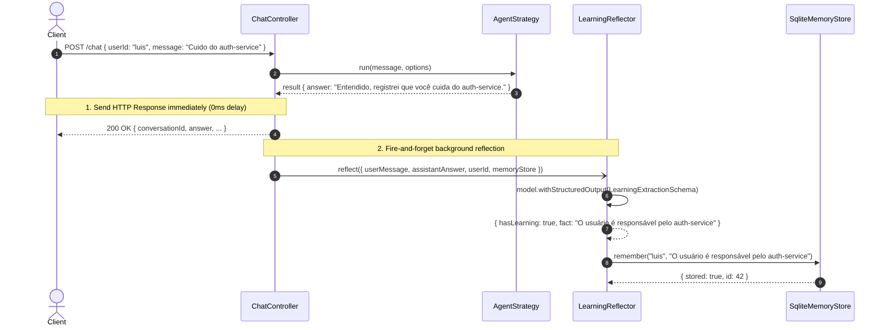

# Data Model: Learning Reflector & Memory Distillation

**Feature**: `009-learning-reflector` | **Date**: 2026-09-30

---

## 1. Structured Output Entities

### Schema: `LearningExtractionSchema`

```typescript
// src/memory/reflector.ts

export const LearningExtractionSchema = z.object({
  hasLearning: z.boolean().describe(
    "true se a mensagem declarar fato ou preferência operacional duradoura; false para ações efêmeras, dúvidas pontuais ou saudações"
  ),
  fact: z.string().optional().describe(
    "Fato operacional duradouro em terceira pessoa (ex: 'O usuário é responsável pelo auth-service'). Omitido se hasLearning for false."
  ),
});

export type LearningExtraction = z.infer<typeof LearningExtractionSchema>;
```

### Tool Schema: `ForgetPreferenceSchema`

```typescript
// src/agents/tools.ts

export const ForgetPreferenceSchema = z.object({
  queryOrId: z.string().describe("Descrição em texto da preferência a ser esquecida ou seu ID numérico"),
  userId: z.string().optional().describe("Identificador do usuário (opcional se fornecido no contexto)"),
});

export type ForgetPreferenceInput = z.infer<typeof ForgetPreferenceSchema>;
```

---

## 2. Reflector Service Interface

```typescript
export interface ReflectionInput {
  userMessage: string;
  assistantAnswer: string;
  userId: string;
  memoryStore: IMemoryStore;
}

export interface ILearningReflector {
  /**
   * Evaluates interaction and distills durable fact asynchronously.
   * If hasLearning: true, calls memoryStore.remember(userId, fact).
   */
  reflect(input: ReflectionInput): Promise<LearningExtraction>;
}
```

---

## 3. Sequence Flow: Background Reflection


