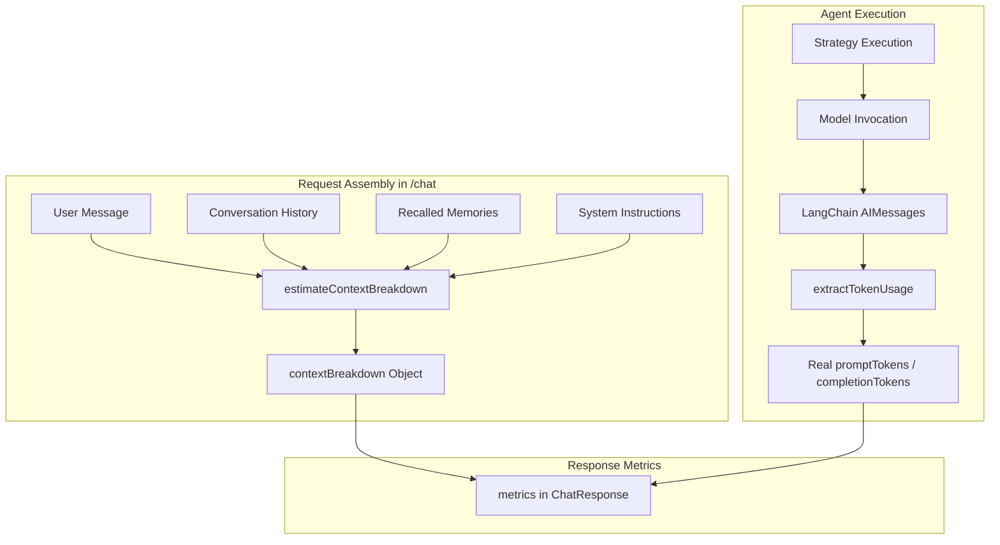

# Data Model: Context Tokens & Metrics

**Feature**: `011-context-tokens-metrics` | **Date**: 2026-10-03

---

## 1. Entities & Schemas

### `ContextBreakdownSchema`
Defines the breakdown of estimated tokens across prompt components:
```typescript
import { z } from "zod";

export const ContextBreakdownSchema = z.object({
  system: z.number().int().nonnegative().describe("Estimated tokens from system prompt and tools"),
  history: z.number().int().nonnegative().describe("Estimated tokens from conversation history"),
  memories: z.number().int().nonnegative().describe("Estimated tokens from semantic memories"),
  userMessage: z.number().int().nonnegative().describe("Estimated tokens from current user message"),
  totalEstimated: z.number().int().nonnegative().describe("Sum of all estimated prompt components"),
});

export type ContextBreakdown = z.infer<typeof ContextBreakdownSchema>;
```

### `TokenUsageSchema`
Represents real token counts extracted from model providers:
```typescript
export const TokenUsageSchema = z.object({
  promptTokens: z.number().int().nonnegative().describe("Real prompt/input tokens reported by LLM"),
  completionTokens: z.number().int().nonnegative().describe("Real completion/output tokens reported by LLM"),
  totalTokens: z.number().int().nonnegative().describe("Total tokens consumed in the operation"),
});

export type TokenUsage = z.infer<typeof TokenUsageSchema>;
```

### Updated `StrategyMetricsSchema` (`src/agents/types.ts`)
```typescript
export const StrategyMetricsSchema = z.object({
  llmCalls: z.number().int().nonnegative(),
  latencyMs: z.number().int().nonnegative(),
  historyMessages: z.number().int().nonnegative().optional(),
  promptTokens: z.number().int().nonnegative().optional(),
  completionTokens: z.number().int().nonnegative().optional(),
  totalTokens: z.number().int().nonnegative().optional(),
  contextBreakdown: ContextBreakdownSchema.optional(),
});

export type StrategyMetrics = z.infer<typeof StrategyMetricsSchema>;
```

---

## 2. Relationships & Flow


