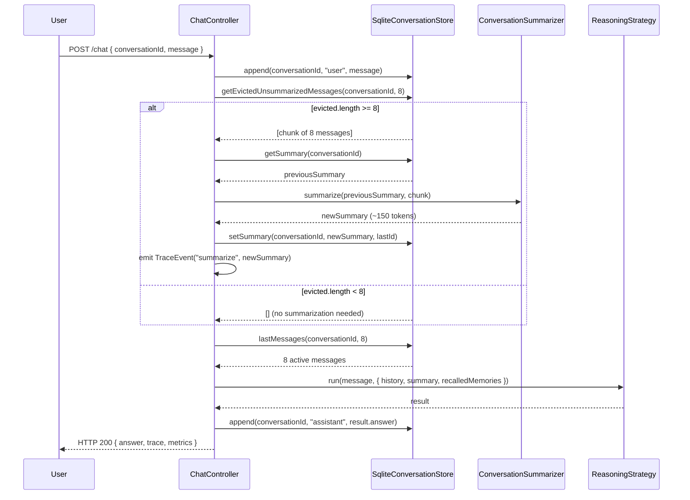

# Data Model: Conversation Summaries & History Pruning

**Feature**: `012-history-summary-pruning` | **Date**: 2026-10-03

---

## 1. Database Schema (`node:sqlite`)

### Table: `conversation_summaries`
```sql
CREATE TABLE IF NOT EXISTS conversation_summaries (
  conversation_id             TEXT    PRIMARY KEY,
  summary                     TEXT    NOT NULL,
  last_summarized_message_id  INTEGER NOT NULL,
  updated_at                  TEXT    NOT NULL DEFAULT (datetime('now'))
);
```

### Table: `messages` (Existing)
```sql
CREATE TABLE IF NOT EXISTS messages (
  id              INTEGER PRIMARY KEY AUTOINCREMENT,
  conversation_id TEXT    NOT NULL,
  role            TEXT    NOT NULL CHECK(role IN ('user','assistant')),
  content         TEXT    NOT NULL,
  created_at      TEXT    NOT NULL DEFAULT (datetime('now'))
);
```

---

## 2. TypeScript Domain Types

```typescript
export interface ConversationSummary {
  conversationId: string;
  summary: string;
  lastSummarizedMessageId: number;
  updatedAt: Date;
}

export interface IConversationStore {
  create(): string;
  append(conversationId: string, role: "user" | "assistant", content: string): void;
  lastMessages(conversationId: string, limit?: number): ConversationMessage[];
  getSummary(conversationId: string): ConversationSummary | null;
  setSummary(conversationId: string, summary: string, lastSummarizedMessageId: number): void;
  getEvictedUnsummarizedMessages(conversationId: string, windowSize?: number): ConversationMessage[];
  close(): void;
}
```

---

## 3. Context Breakdown Extension

```typescript
export const ContextBreakdownSchema = z.object({
  system: z.number().int().nonnegative().optional(),
  summary: z.number().int().nonnegative().optional(),
  history: z.number().int().nonnegative().optional(),
  memories: z.number().int().nonnegative().optional(),
  userMessage: z.number().int().nonnegative().optional(),
  totalEstimated: z.number().int().nonnegative().optional(),
});
```

---

## 4. Trace Event Schema Extension

```typescript
export const TraceEventTypeSchema = z.enum([
  "thought",
  "action",
  "observation",
  "plan",
  "critique",
  "answer",
  "summarize", // NEW
]);
```

---

## 5. Lifecycle Flow


