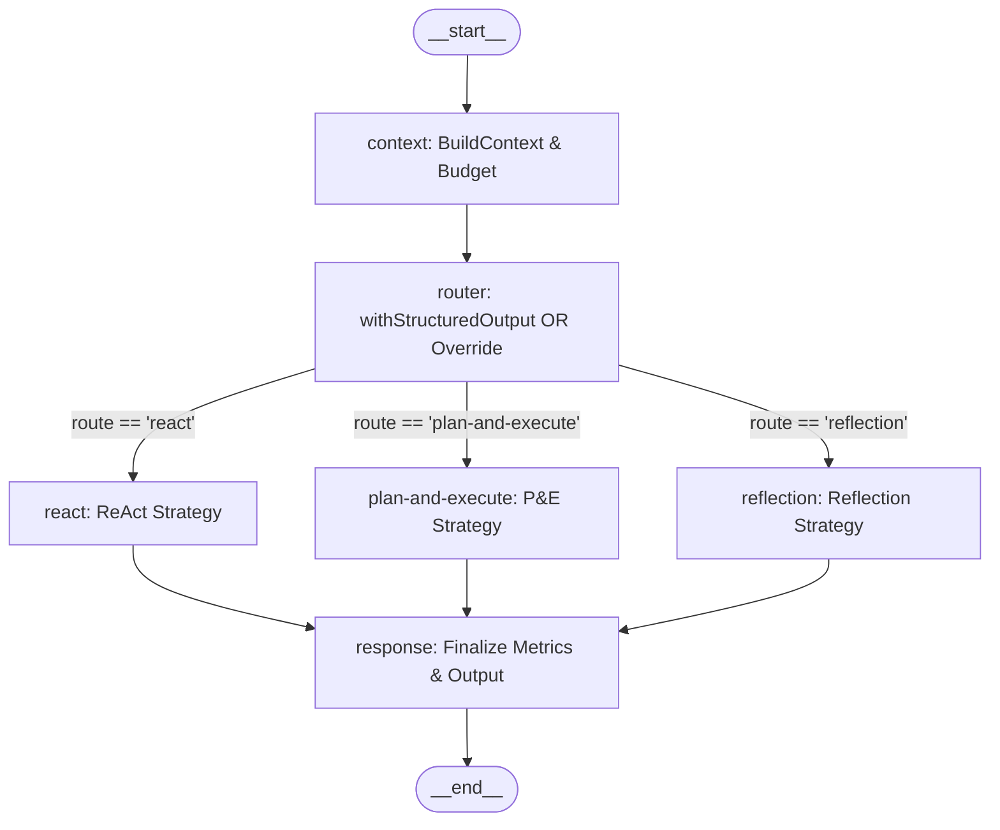

# Data Model: Unified Production Graph (`production-graph.ts`)

**Feature**: Unified Production Graph  
**Branch**: `014-unified-production-graph`  
**Date**: 2026-10-19  

## Entities & Schemas

### 1. `RouteDecision`
Represents the structured classification result emitted by the router node or derived from an operator override.

```typescript
export const RouteDecisionSchema = z.object({
  route: z
    .enum(["react", "plan-and-execute", "reflection"])
    .describe("Estratégia operacional selecionada"),
  reason: z
    .string()
    .describe("Justificativa da escolha com base na complexidade e criticidade do pedido"),
});

export type RouteDecision = z.infer<typeof RouteDecisionSchema>;
```

---

### 2. `TraceEvent` with Node Attribution & Route Type
Every event carries a mandatory `node` attribute identifying the generating graph node.

```typescript
export const TraceEventTypeSchema = z.enum([
  "thought",
  "action",
  "observation",
  "plan",
  "critique",
  "answer",
  "summarize",
  "route", // NEW
]);

export const BaseTraceEventSchema = z.object({
  type: TraceEventTypeSchema,
  node: z.string().min(1).describe("Nome do nó do grafo que gerou o evento"), // NEW mandatory node
  content: z.string(),
  timestamp: z.number().int().nonnegative(),
});

export const ActionTraceEventSchema = BaseTraceEventSchema.extend({
  type: z.literal("action"),
  tool: z.string().min(1),
  args: z.record(z.string(), z.unknown()),
});

export const RouteTraceEventSchema = BaseTraceEventSchema.extend({
  type: z.literal("route"),
  route: z.enum(["react", "plan-and-execute", "reflection"]),
  reason: z.string(),
});

export const TraceEventSchema = z.discriminatedUnion("type", [
  ActionTraceEventSchema,
  RouteTraceEventSchema,
  BaseTraceEventSchema.extend({
    type: z.enum(["thought", "observation", "plan", "critique", "answer", "summarize"]),
  }),
]);

export type TraceEvent = z.infer<typeof TraceEventSchema>;
```

---

### 3. `ProductionGraphState`
The centralized state passed and transformed across all nodes in the production graph.

```typescript
export const ProductionGraphState = Annotation.Root({
  // Input parameters
  input: Annotation<string>(),
  conversationId: Annotation<string>(),
  userId: Annotation<string | undefined>({
    reducer: (_a, b) => b,
    default: () => undefined,
  }),
  strategyOverride: Annotation<string | undefined>({
    reducer: (_a, b) => b,
    default: () => undefined,
  }),
  history: Annotation<HistoryMessage[]>({
    reducer: (_a, b) => b,
    default: () => [],
  }),
  summary: Annotation<string | undefined>({
    reducer: (_a, b) => b,
    default: () => undefined,
  }),
  recalledMemories: Annotation<MemoryItem[] | undefined>({
    reducer: (_a, b) => b,
    default: () => undefined,
  }),
  budgets: Annotation<Partial<ContextBudgets> | undefined>({
    reducer: (_a, b) => b,
    default: () => undefined,
  }),

  // State populated by `context` node
  context: Annotation<BuiltContext | undefined>({
    reducer: (_a, b) => b,
    default: () => undefined,
  }),

  // State populated by `router` node
  selectedRoute: Annotation<"react" | "plan-and-execute" | "reflection" | undefined>({
    reducer: (_a, b) => b,
    default: () => undefined,
  }),
  routeReason: Annotation<string | undefined>({
    reducer: (_a, b) => b,
    default: () => undefined,
  }),

  // Strategy output and final resolution
  answer: Annotation<string | undefined>({
    reducer: (_a, b) => b,
    default: () => undefined,
  }),
  trace: Annotation<TraceEvent[]>({
    reducer: (a, b) => a.concat(b),
    default: () => [],
  }),
  llmCalls: Annotation<number>({
    reducer: (a, b) => a + b,
    default: () => 0,
  }),
  metrics: Annotation<StrategyMetrics | undefined>({
    reducer: (_a, b) => b,
    default: () => undefined,
  }),
});

export type ProductionGraphStateType = typeof ProductionGraphState.State;
```

---

### 4. Graph Transitions & Flow


