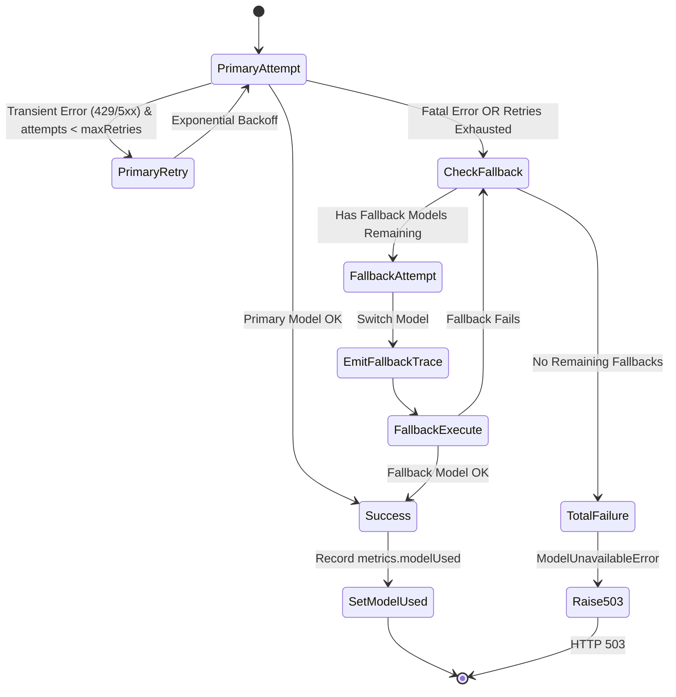

# Data Model: Model Fallback & Retry Resilience

**Feature Branch**: `015-model-fallback-resilience`  
**Date**: 2026-10-21  

## Entities & Schemas

### 1. `FallbackModelsConfig`

Defines the parsed configuration for resilient model creation:

| Field | Type | Required | Description |
|---|---|---|---|
| `primaryModel` | `string` | Yes | Name/identifier of primary LLM (from `OPENROUTER_MODEL`) |
| `fallbackModels` | `string[]` | Yes | Ordered array of unique fallback LLM names (from `OPENROUTER_MODEL_FALLBACK`) |
| `maxRetries` | `number` | No | Maximum retry attempts on the primary model (default: 2) |
| `timeoutMs` | `number` | No | Timeout per LLM attempt in milliseconds |

**Validation Rules**:
- `primaryModel` must be a non-empty string.
- `fallbackModels` is filtered to exclude empty strings and any model name matching `primaryModel`.
- `maxRetries` is a non-negative integer.

---

### 2. `FallbackTraceEvent`

Extends `BaseTraceEventSchema` to record model failover events:

```ts
export const FallbackTraceEventSchema = BaseTraceEventSchema.extend({
  type: z.literal("fallback"),
  fromModel: z.string().min(1),
  toModel: z.string().min(1),
  reason: z.string(),
});
```

| Field | Type | Description |
|---|---|---|
| `type` | `"fallback"` | Discriminator literal |
| `node` | `string` | Graph node originating the LLM call (e.g., `"router"`, `"react"`, `"reflection"`) |
| `content` | `string` | Human-readable explanation of the fallback |
| `timestamp` | `number` | Unix epoch milliseconds |
| `fromModel` | `string` | Identifier of model that failed |
| `toModel` | `string` | Identifier of target fallback model taking over |
| `reason` | `string` | Error summary or status code triggering the fallback |

---

### 3. `StrategyMetrics` Extension

Extended with `modelUsed`:

```ts
export const StrategyMetricsSchema = z.object({
  llmCalls: z.number().int().nonnegative(),
  latencyMs: z.number().int().nonnegative(),
  historyMessages: z.number().int().nonnegative().optional(),
  promptTokens: z.number().int().nonnegative().optional(),
  completionTokens: z.number().int().nonnegative().optional(),
  totalTokens: z.number().int().nonnegative().optional(),
  contextBreakdown: ContextBreakdownSchema.optional(),
  modelUsed: z.string().optional(),
});
```

| Field | Type | Description |
|---|---|---|
| `modelUsed` | `string` (optional) | The model that successfully completed the inference and produced the response |

---

### 4. `ModelUnavailableError` (Domain Error)

```ts
export class ModelUnavailableError extends Error {
  readonly code = "model_unavailable";
  readonly attemptedModels: string[];
  readonly lastError?: unknown;

  constructor(message: string, attemptedModels: string[] = [], lastError?: unknown) {
    super(message);
    this.name = "ModelUnavailableError";
    this.attemptedModels = attemptedModels;
    this.lastError = lastError;
  }
}
```

---

## State Transition Diagram


