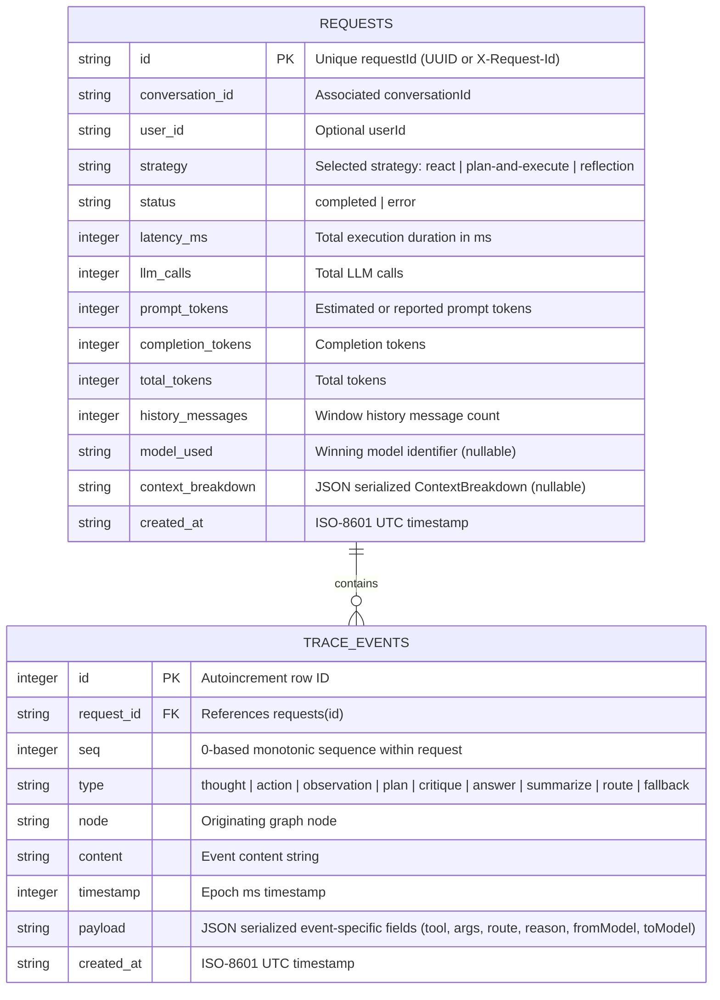
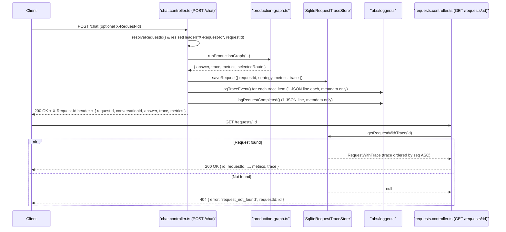

# Data Model: Persisted Trace & Structured JSON Logs

**Feature Branch**: `016-persisted-trace-json-logs`  
**Date**: 2026-11-17  

---

## Entity-Relationship Overview



---

## SQLite DDL Schema

Both tables are created idempotently in `SqliteRequestTraceStore.#runDDL()` (`node:sqlite` `DatabaseSync`):

```sql
CREATE TABLE IF NOT EXISTS requests (
  id                TEXT    PRIMARY KEY,
  conversation_id   TEXT    NOT NULL,
  user_id           TEXT,
  strategy          TEXT    NOT NULL,
  status            TEXT    NOT NULL DEFAULT 'completed',
  latency_ms        INTEGER NOT NULL,
  llm_calls         INTEGER NOT NULL,
  prompt_tokens     INTEGER NOT NULL DEFAULT 0,
  completion_tokens INTEGER NOT NULL DEFAULT 0,
  total_tokens      INTEGER NOT NULL DEFAULT 0,
  history_messages  INTEGER NOT NULL DEFAULT 0,
  model_used        TEXT,
  context_breakdown TEXT,
  created_at        TEXT    NOT NULL DEFAULT (datetime('now'))
);

CREATE TABLE IF NOT EXISTS trace_events (
  id          INTEGER PRIMARY KEY AUTOINCREMENT,
  request_id  TEXT    NOT NULL REFERENCES requests(id) ON DELETE CASCADE,
  seq         INTEGER NOT NULL,
  type        TEXT    NOT NULL,
  node        TEXT    NOT NULL,
  content     TEXT    NOT NULL,
  timestamp   INTEGER NOT NULL,
  payload     TEXT    NOT NULL DEFAULT '{}',
  created_at  TEXT    NOT NULL DEFAULT (datetime('now'))
);

CREATE INDEX IF NOT EXISTS idx_trace_events_request_seq
  ON trace_events (request_id, seq ASC);
```

---

## Domain Interfaces & Zod Schemas

### 1. `RequestRecord` (`src/models/request-trace.ts`)

| Field | Type | Required | Description |
|---|---|---|---|
| `id` | `string` | Yes | Primary identifier (`requestId`) |
| `requestId` | `string` | Yes | Correlation identifier (identical to `id`) |
| `conversationId` | `string` | Yes | Conversation session ID |
| `userId` | `string` | No | Optional user identifier |
| `strategy` | `"react" \| "plan-and-execute" \| "reflection"` | Yes | Strategy executed by the production graph |
| `status` | `string` | Yes | Request execution status (e.g., `"completed"`) |
| `metrics` | `StrategyMetrics` | Yes | Reconstructed execution metrics object |
| `createdAt` | `string` | Yes | ISO-8601 timestamp string |

---

### 2. `PersistedTraceEventRow` & Payload Mapping

Represents a raw row in `trace_events` and its mapping back into a canonical `TraceEvent`:

| Column | Type | Description |
|---|---|---|
| `id` | `number` | Autoincrement primary key |
| `request_id` | `string` | Foreign key referencing `requests.id` |
| `seq` | `number` | 0-based emission order inside the request |
| `type` | `TraceEventType` | Discriminator (`thought`, `action`, `observation`, `plan`, `critique`, `answer`, `summarize`, `route`, `fallback`) |
| `node` | `string` | Originating LangGraph node (`context`, `router`, `react`, `plan-and-execute`, `reflection`, `response`) |
| `content` | `string` | Trace event message/text |
| `timestamp` | `number` | Unix epoch ms |
| `payload` | `string` | JSON string encoding event-specific fields |

**Payload Extraction Rules (Pure Helper `extractTracePayload`)**:
- `action`: `{ tool, args }`
- `route`: `{ route, reason }`
- `fallback`: `{ fromModel, toModel, reason }`
- All other types (`thought`, `observation`, `plan`, `critique`, `answer`, `summarize`): `{}`

**Payload Reconstruction Rules (Pure Helper `reconstructTraceEvent`)**:
Merges `{ type, node, content, timestamp }` with parsed `payload` fields so `GET /requests/:id` returns items strictly conforming to `TraceEventSchema`.

---

### 3. `RequestWithTrace` & `IRequestTraceStore`

```ts
export interface SaveRequestTraceInput {
  requestId: string;
  conversationId: string;
  userId?: string;
  strategy: "react" | "plan-and-execute" | "reflection";
  status?: string;
  metrics: StrategyMetrics;
  trace: TraceEvent[];
  createdAt?: string;
}

export interface RequestWithTrace extends RequestRecord {
  trace: TraceEvent[];
}

export interface IRequestTraceStore {
  saveRequest(input: SaveRequestTraceInput): void;
  getRequestWithTrace(requestId: string): RequestWithTrace | null;
  close?(): void;
}
```

---

### 4. Structured Logger Metadata Entities (`src/obs/logger.ts`)

Logs strictly enforce metadata-only fields using allowlist construction (`TraceLogMetadata`, `RequestLogMetadata`) so raw user messages, prompts, answers, and tool argument values are never serialized.

#### `TraceLogMetadata`

| Field | Type | Always Present | Description |
|---|---|---|---|
| `timestamp` | `string` | Yes | ISO-8601 timestamp |
| `level` | `"info" \| "warn" \| "error"` | Yes | Log severity |
| `event` | `"trace_event"` | Yes | Log record discriminator |
| `requestId` | `string` | Yes | Request correlation ID |
| `conversationId` | `string` | No | Conversation ID |
| `seq` | `number` | No | Sequence index of the trace event |
| `type` | `TraceEventType` | Yes | Trace event type |
| `node` | `string` | Yes | Originating graph node |
| `contentLength` | `number` | Yes | Character count of `event.content` (replaces raw content) |
| `tool` | `string` | Conditional | Included only for `action` events |
| `argKeys` | `string[]` | Conditional | Included only for `action` events (key names only, never values) |
| `route` | `string` | Conditional | Included only for `route` events |
| `fromModel` | `string` | Conditional | Included only for `fallback` events |
| `toModel` | `string` | Conditional | Included only for `fallback` events |

#### `RequestLogMetadata`

| Field | Type | Always Present | Description |
|---|---|---|---|
| `timestamp` | `string` | Yes | ISO-8601 timestamp |
| `level` | `"info" \| "warn" \| "error"` | Yes | Log severity |
| `event` | `"request_completed" \| "request_failed"` | Yes | Lifecycle discriminator |
| `requestId` | `string` | Yes | Request correlation ID |
| `conversationId` | `string` | No | Conversation ID |
| `userId` | `string` | No | User ID (if provided) |
| `strategy` | `string` | No | Executed strategy |
| `statusCode` | `number` | Yes | HTTP status code (e.g., `200`, `503`, `504`, `500`) |
| `latencyMs` | `number` | No | Total execution duration in ms |
| `llmCalls` | `number` | No | Total LLM calls |
| `promptTokens` | `number` | No | Total prompt tokens |
| `completionTokens` | `number` | No | Total completion tokens |
| `totalTokens` | `number` | No | Total tokens |
| `historyMessages` | `number` | No | Active history message count |
| `modelUsed` | `string` | No | Model that served the response |
| `traceCount` | `number` | No | Number of trace events emitted |
| `errorCode` | `string` | Conditional | Error identifier on failed requests |

**Forbidden Raw Payload Keys (Never Emitted)**:
`content`, `message`, `userMessage`, `answer`, `prompt`, `args`, `summary`, `observation`, `fact`, `history`, `memories`.

---

### 5. HTTP Boundary Schemas (`src/http/schemas.ts`)

```ts
export const ChatResponseSchema = StrategyResultSchema.extend({
  requestId: z.string().min(1),
  conversationId: z.string(),
  userId: z.string().optional(),
});

export const GetRequestParamsSchema = z.object({
  id: z.string().trim().min(1, "request id is required"),
});

export const RequestTraceResponseSchema = z.object({
  id: z.string().min(1),
  requestId: z.string().min(1),
  conversationId: z.string(),
  userId: z.string().optional(),
  strategy: StrategyEnumSchema,
  status: z.string(),
  createdAt: z.string(),
  metrics: StrategyMetricsSchema,
  trace: z.array(TraceEventSchema),
});

export const RequestNotFoundResponseSchema = z.object({
  error: z.literal("request_not_found"),
  requestId: z.string(),
});
```

---

## Request Execution & Persistence Flow


