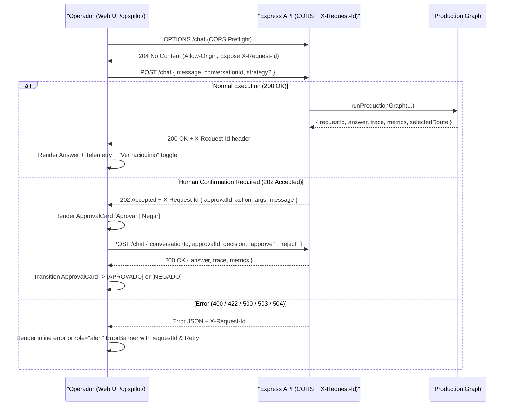

# Data Model: OpsPilot War Room Web UI (`web/`) & CORS

**Feature Branch**: `018-war-room-web`  
**Date**: 2026-11-20  

---

## State & Request Lifecycle Diagram



---

## Frontend & Boundary Entities

### 1. `WarRoomSettings` (`web/src/lib/url.ts`)

| Field | Type | Default | Description |
|---|---|---|---|
| `apiUrl` | `string` | `VITE_API_URL` or `"http://localhost:3000"` | Normalized base URL without trailing slash |
| `theme` | `"dark" \| "light"` | `"dark"` (or OS `prefers-color-scheme`) | Active UI theme applied to `document.documentElement.dataset.theme` |

**Validation Rules**:
- Must parse cleanly via `new URL(value)` with `protocol === "http:" || protocol === "https:"`.
- Trailing slashes removed (`http://localhost:3000/` → `http://localhost:3000`).

---

### 2. `TypedTraceEvent` (`web/src/lib/trace.ts`)

Mirrors backend `TraceEventSchema` discriminated union:

| Type | Variant Fields | Visual Badge | Monospace Telemetry |
|---|---|---|---|
| `route` | `route`, `reason` | `[ROTA]` | Target strategy (`react` \| `plan-and-execute` \| `reflection`) |
| `thought` | `content` | `[PENSAMENTO]` | Originating `node` |
| `action` | `tool`, `args` | `[AÇÃO]` | Tool name + formatted JSON `args` |
| `observation` | `content` | `[OBSERVAÇÃO]` | Truncatable observation block |
| `plan` | `content` | `[PLANO]` | Step plan summary |
| `critique` | `content` | `[CRÍTICA]` | Reflection verdict feedback |
| `fallback` | `fromModel`, `toModel`, `reason` | `[FALLBACK]` | `fromModel -> toModel` transition |
| `summarize` | `content` | `[RESUMO]` | Rolling summary content |
| `answer` | `content` | `[RESPOSTA]` | Consolidated output |

Every event displays `node` (`router`, `react`, `plan-and-execute`, `reflection`, `response`, `context`) and relative/formatted timestamp.

---

### 3. `PendingApprovalPayload` & `ApprovalStatus`

Returned on HTTP `202 Accepted` from `POST /chat` and used by `ApprovalCard`:

```ts
export type ApprovalDecision = "approve" | "reject";
export type ApprovalStatus = "pending" | "submitting" | "approved" | "rejected" | "error";

export interface PendingApprovalPayload {
  status: "pending_approval";
  approvalId: string;
  requestId: string;
  conversationId: string;
  action: string;
  tool?: string;
  args?: Record<string, unknown>;
  reason?: string;
  message: string;
  trace?: TypedTraceEvent[];
  metrics?: StrategyMetrics;
}
```

---

### 4. `ChatTimelineItem` (`web/src/types/war-room.ts`)

Discriminated union driving the War Room timeline:
- `kind: "user"` — `{ id, message, strategy?, timestamp }`
- `kind: "assistant"` — `{ id, requestId, conversationId, answer, selectedRoute, routeReason, trace, metrics, timestamp }`
- `kind: "approval"` — `{ id, requestId, conversationId, payload: PendingApprovalPayload, approvalStatus: ApprovalStatus, resolutionAnswer?: string, resolutionError?: string, timestamp }`
- `kind: "error"` — `{ id, statusCode, errorCode, message, requestId?, retryMessage?: string, timestamp }`

---

### 5. `StatsSummaryView` (`GET /stats?since=24h`)

Subset rendered in the compact operational status strip:
- `since`, `total`, `errors`, `cost`, `p50`, `p95`, `byRoute`, `byModel`.

---

## Backend Schema Additions (`src/http/schemas.ts`)

- `ChatRequestSchema` extended with optional approval fields:
  - `requireApproval: z.boolean().optional()`
  - `approvalId: z.string().trim().min(1).optional()`
  - `decision: z.enum(["approve", "reject"]).optional()`
  - `approved: z.boolean().optional()`
- `PendingApprovalResponseSchema`:
  - Validates HTTP `202` payload `{ status: "pending_approval", approvalId, requestId, conversationId, action, tool?, args?, reason?, message, trace?, metrics? }`.
