# Data Model & Pipeline Flow: GitHub Pages Deployment & `README.md`

**Feature Branch**: `019-pages-deploy-web`  
**Date**: 2026-11-20  

---

## CI/CD Pipeline Flow

```mermaid
flowchart LR
    T["Trigger: push main (web/**) or workflow_dispatch"] --> B1["Checkout + Node 22 + cache web/package-lock.json"]
    B1 --> B2["npm --prefix web ci"]
    B2 --> B3["npm --prefix web run typecheck"]
    B3 --> B4["npm --prefix web run build (/opspilot/ -> web/dist)"]
    B4 --> B5["actions/configure-pages@v5"]
    B5 --> B6["actions/upload-pages-artifact@v3 (path: ./web/dist)"]
    B6 --> D1["deploy job (needs: build, env: github-pages)"]
    D1 --> D2["actions/deploy-pages@v4 -> page_url"]
```

---

## Entities

### 1. `PagesWorkflowConfig` (`.github/workflows/deploy-pages.yml`)

| Field | Value / Constraint | Purpose |
|---|---|---|
| `on.push.branches` | `["main"]` (`paths: ["web/**", ".github/workflows/deploy-pages.yml"]`) | Automatic deployment when frontend or workflow changes on `main` |
| `on.workflow_dispatch` | `{}` | Manual trigger from GitHub Actions tab |
| `permissions.contents` | `read` | Minimum checkout access |
| `permissions.pages` | `write` | Required to publish GitHub Pages deployments |
| `permissions.id-token` | `write` | Required for GitHub OIDC Pages token authentication |
| `concurrency.group` | `"pages"` | Serializes active Pages deployments |
| `concurrency.cancel-in-progress` | `false` | Allows an active deployment to finish safely |

### 2. `PagesArtifactBundle`

| Field | Value | Notes |
|---|---|---|
| Source directory | `./web/dist` | Built via `npm --prefix web run build` |
| Base path | `/opspilot/` | Configured in `web/vite.config.ts` (`base: "/opspilot/"`) |
| Entry document | `web/dist/index.html` | Asset tags prefixed with `/opspilot/assets/...` |
| Publisher action | `actions/upload-pages-artifact@v3` -> `actions/deploy-pages@v4` | Uploaded in `build`, deployed in `deploy` under `github-pages` environment |

### 3. `ReadmeDocumentationModel` (`README.md`)

Required verified sections in repository root `README.md`:
1. Project summary & War Room / LangGraph architecture
2. Stack & prerequisites (Node.js 22 LTS, TypeScript ESM, SQLite `node:sqlite`, Vite + React + TS)
3. Environment configuration (variable names from `src/config/env.ts` with placeholder examples only)
4. Local execution & test commands (root API/CLI/tests + `web/` dev/build/tests)
5. HTTP API endpoints overview (`/chat`, `/requests/:id`, `/stats`, `/memories`)
6. GitHub Pages (`web/`) deployment & runtime API URL Settings Gear usage
